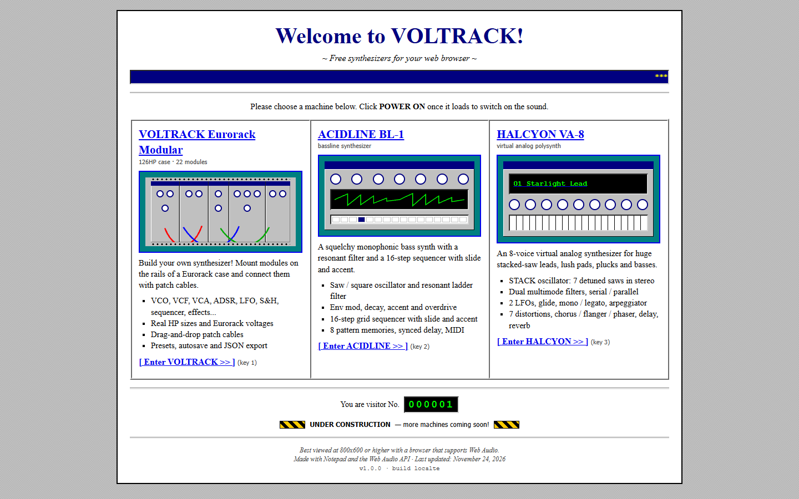
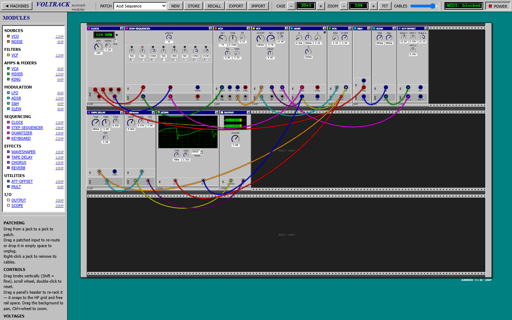
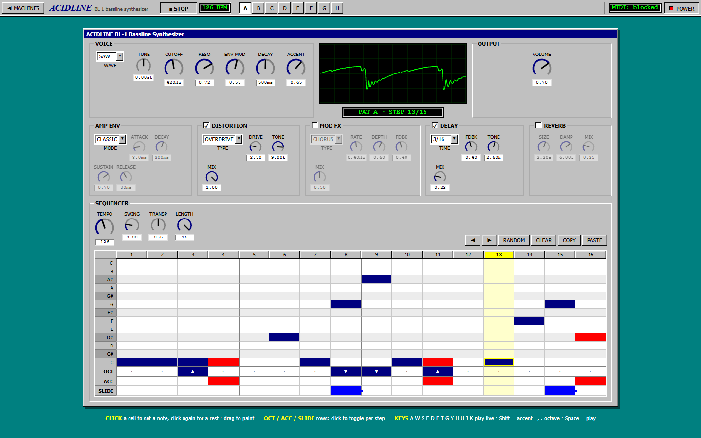
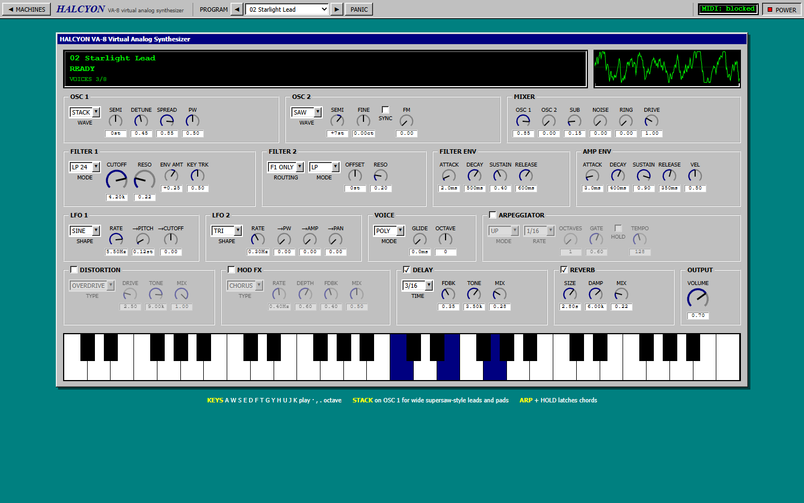
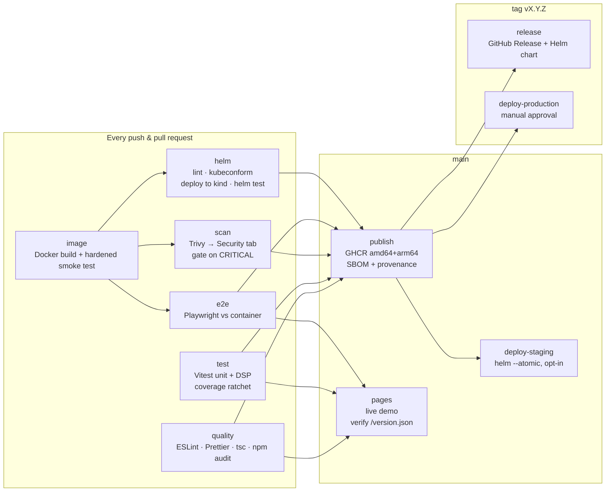
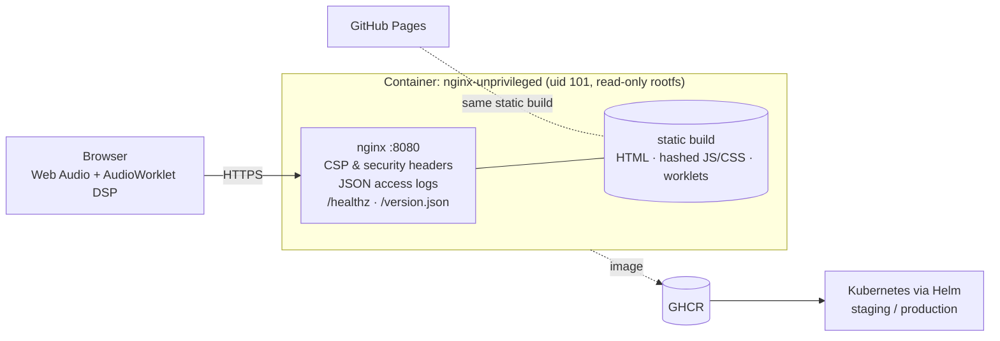

# VOLTRACK

[](https://github.com/DevoArn/VOLTRACK/actions/workflows/ci.yml)
[](https://github.com/DevoArn/VOLTRACK/actions/workflows/codeql.yml)

**Three browser synthesizers, built and shipped like a production service.**

VOLTRACK is a static web app: a Eurorack modular, an acid-bassline machine and an 8-voice virtual-analog polysynth, all running real-time DSP in AudioWorklets. This repository is a DevOps portfolio project. The interesting part is how the app is built, tested, secured, packaged and deployed.

| Start page                          | Eurorack modular                            |
| ----------------------------------- | ------------------------------------------- |
|  |  |
| **ACIDLINE BL-1**                   | **HALCYON VA-8**                            |
|     |           |

**Live demo:** `https://devoarn.github.io/VOLTRACK/` (deployed by the pipeline on every push to `main`) · [Instrument manual](Doc/SYNTHS.md) · [Runbook](Doc/RUNBOOK.md)

---

## What this project demonstrates

- **CI/CD on GitHub Actions:** a single pipeline graph from commit to production. Parallel quality gates are followed by build, scan, test and deploy stages, ending in tag-driven releases.
- **Testing:**
  - 113 unit and DSP tests. These include a harness that runs the shipped AudioWorklet code inside a Node `vm` sandbox, to check pitch accuracy, filter response, sequencer timing and numerical stability.
  - 15 Playwright E2E tests that run against the real production container and fail on any browser console error (CSP violations included).
- **Hardened container:**
  - Multi-stage build and a non-root nginx (uid 101) that works on a read-only root filesystem.
  - CSP and the other security headers, structured JSON access logs, OCI labels, and a healthcheck.
  - A `/version.json` endpoint for deployment verification.
- **Supply chain:**
  - Multi-arch images (amd64 + arm64) pushed to GHCR, with SBOM and SLSA provenance attestations.
  - Trivy scanning into GitHub code scanning, CodeQL, and Dependabot for npm, Docker and Actions.
- **Kubernetes:**
  - A Helm chart with pod and container security contexts, probes, resource limits, a PDB, an HPA, a NetworkPolicy and Ingress with TLS.
  - Validated with kubeconform and **actually deployed into an ephemeral kind cluster on every run**, with `helm test` and a commit check.
- **Progressive delivery:** `main` deploys to the live demo and (optionally) staging. Version tags deploy to production behind a manual approval gate. Rollouts use `helm upgrade --atomic` with immutable image digests, so a failed rollout rolls back automatically.
- **Operability:** a [runbook](Doc/RUNBOOK.md) covers verification, rollback, troubleshooting and log queries.

## Pipeline



Every deploy job verifies itself: it fetches `/version.json` from the target and fails unless the live commit equals the commit being deployed.

## Architecture



All audio processing happens in the browser, so the server is a hardened static file host. That keeps the runtime tiny (about 21 MB image, 16 MiB memory request) and lets the same build ship both to GitHub Pages and to Kubernetes.

## Quality gates

| Gate                 | Tooling                                                     | Fails the build when…                                       |
| -------------------- | ----------------------------------------------------------- | ----------------------------------------------------------- |
| Lint                 | ESLint (typescript-eslint, AudioWorklet globals)            | any error                                                   |
| Format               | Prettier                                                    | any file isn't formatted                                    |
| Types                | TypeScript strict                                           | any type error                                              |
| Unit + DSP tests     | Vitest (Node `vm` worklet harness, fake Web Audio graph)    | any failure, or coverage below the ratchet                  |
| Container smoke test | Docker with `--read-only --cap-drop ALL`                    | not uid 101, no CSP header, wrong commit in `/version.json` |
| Vulnerabilities      | Trivy (image) + CodeQL (source)                             | a fixable CRITICAL CVE                                      |
| E2E                  | Playwright against the nginx image                          | any test fails or any console error / CSP violation         |
| Kubernetes           | `helm lint --strict`, kubeconform, kind deploy, `helm test` | invalid manifests, failed rollout or smoke test             |
| Release              | tag vs `package.json`                                       | versions disagree                                           |

## Run it

```bash
# Production image, hardened exactly like the Kubernetes deployment
docker compose up -d --build
open http://localhost:8080        # pick a machine, press POWER ON

# Development
npm ci
npm run dev                       # http://localhost:5173
```

> Web Audio worklets need a **secure context**: `localhost` or HTTPS. See the [runbook](Doc/RUNBOOK.md#troubleshooting).

## Test it

```bash
npm run check                     # lint + format + typecheck + unit/DSP tests
npm run test:coverage             # with coverage report in coverage/
npx playwright install chromium   # once (or set PW_CHANNEL=chrome to use installed Chrome)
npm run test:e2e                  # builds and serves the app, runs the browser suite

# E2E against the production container, as CI does
docker compose up -d --build
BASE_URL=http://localhost:8080/ E2E_EXPECT_HEADERS=1 npm run test:e2e
```

## Deploy it

The pipeline needs no secrets for the default path: GHCR uses the built-in `GITHUB_TOKEN`.

1. **Push** this repository to GitHub.
2. **Live demo:** _Settings → Pages → Build and deployment → Source: GitHub Actions_. To skip Pages, set the repository variable `PAGES_ENABLED=false`.
3. **Releases:** `npm version minor && git push --follow-tags` publishes semver image tags and creates a GitHub Release with the packaged Helm chart.
4. **Kubernetes (optional):**
   - Create the environments `staging` and `production` (add _Required reviewers_ to `production`).
   - Add an environment secret `KUBE_CONFIG`: a base64-encoded kubeconfig for a namespaced deploy user.
   - Set the repository variable `K8S_DEPLOY_ENABLED=true`, and optionally `APP_URL`.
   - Edit `deployments/helm/environments/*.yaml` for your ingress host and TLS.
   - If the GHCR package is private, add `imagePullSecrets`.

Manual install:

```bash
helm upgrade --install voltrack deployments/helm/voltrack -n voltrack --create-namespace \
  --set image.repository=ghcr.io/DevoArn/VOLTRACK --set image.tag=1.0.0 --atomic --wait
helm test voltrack -n voltrack
```

## Engineering notes

Decisions and problems worth calling out:

- **The build stage runs on `$BUILDPLATFORM`.** The output is arch-independent static files, so multi-arch images only emulate the tiny nginx stage, not `npm ci` and Vite.
- **nginx `add_header` inheritance.** A `location` that sets its own `add_header` silently drops the server-level security headers. All headers live in one snippet that is included in every location, and E2E asserts they're present on hashed assets too.
- **Secure context in CI.** Running the E2E suite in Linux containers showed that hitting the app via a non-`localhost` hostname disables AudioWorklet. CI therefore tests via `localhost`, and production must use HTTPS (documented in the chart's `NOTES.txt`).
- **DSP tested without a browser.** The real worklet files run in a `vm` sandbox with a stubbed `AudioWorkletGlobalScope`. The first run caught two wrong test assumptions, not product bugs. Even so, it's the fastest feedback loop in the repo (about 7 s for 113 tests).
- **Cross-platform lockfile.** An npm bug drops Linux-only optional deps when the lockfile is generated on Windows. The fix and the procedure are in the runbook.
- **TypeScript is pinned to 6.0.** typescript-eslint doesn't support the native TypeScript 7 compiler yet, and lint coverage was worth more than the newer compiler.

## Repository layout

```
.github/workflows/ci.yml        CI/CD pipeline (quality → build → scan/e2e/helm → publish → deploy/release)
.github/workflows/codeql.yml    CodeQL static analysis
.github/actions/helm-deploy/    composite action: atomic Helm deploy + smoke test + version check
.github/dependabot.yml          npm, Docker and Actions updates
deployments/helm/voltrack/      Helm chart (hardened Deployment, Service, Ingress, HPA, PDB, NetworkPolicy, helm test)
deployments/helm/environments/  staging / production values
deployments/nginx/              nginx server config + security headers snippet
Dockerfile, docker-compose.yml  multi-stage, non-root, read-only-rootfs image
tests/unit/                     Vitest: catalogue, engine, controls, DSP (modular / acid / va)
tests/e2e/                      Playwright specs + console-error fixture
tests/helpers/                  AudioWorklet vm harness, fake Web Audio graph
public/worklets/                AudioWorklet DSP (all synthesis)
src/                            UI and engine (TypeScript, no framework)
Doc/                            instrument manual, runbook, screenshots
infra/terraform/                infrastructure as code (placeholder, as in the other repos)
```

## License

GPL-3.0-or-later, see [LICENSE](LICENSE). Changes are listed in [CHANGELOG.md](CHANGELOG.md).
